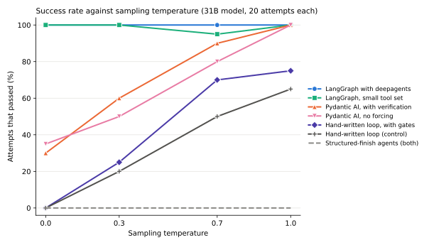

# Appendix: an earlier study of coding-agent designs

This folder holds a self-contained earlier piece of work, kept because its findings
shaped the main project. It asked how to build an effective autonomous coding agent on
a medium-sized language model that you host yourself, and it answered by measurement
rather than opinion. The task it used was debugging small Python projects, not
parallelising kernels, so read it as background to the agent designs in the main
repository and not as part of the main results.

Everything here has its own code, tests and raw results. Nothing in the main package
imports it.

## The question

For a bespoke agent that reviews, debugs, tests, optimises and documents real Python
code, driven by a medium-sized model on your own hardware, which design choices
actually change the success rate, and by how much? The designs compared were a
hand-written loop over plain HTTP, a LangGraph agent built on the deepagents library,
and a Pydantic AI agent.

## The design: one variable at a time

Each phase of the study froze everything except one axis, so that any change in the
result could be put down to that axis:

1. **Agent.** Same model, task and temperature; vary the agent design. Afterwards the
   agent code was frozen so that later phases used an identical set of agents.
2. **Model size.** Run the frozen agents unchanged on a second, larger model.
3. **Sampling temperature.** Sweep the temperature on the larger model.
4. **Task.** Vary the difficulty of the task.

The models were Gemma 4 models served by vLLM (an inference server for language
models) through an OpenAI-compatible endpoint. The 12-billion-parameter model ran at
W4A16 quantisation (weights stored in 4 bits, activations kept in 16 bits, from a
checkpoint produced by quantisation-aware training) on a 24 GB graphics card. The
31-billion-parameter model ran at the same quantisation on a 48 GB card. Both used a
32,000-token context and the Gemma 4 tool-call parser. Scored runs were served one
request at a time. An earlier, smaller trial used Mistral-7B on llama.cpp; its notes
are in `RESULTS.md` and `common/MODEL_NOTES.md`.

The anchor task, `debug-best-weather`, is mechanical. A small data-pipeline project
(`best_weather`) has a failing test suite because its test file imports three function
names that no longer exist, and the fix is to map them to the real functions. The
target projects are the author's own small Python programs and are not included here.

## The harness

The harness in `eval/` scores each agent as follows.

- **Best of N in isolated git worktrees.** Every attempt runs in a fresh worktree of
  the target project, so attempts cannot disturb one another or the real checkout.
  Two attempts ran at a time, with a cap of 900 seconds of wall-clock time each.
- **Automatic checks.** A task passes when the project's test suite passes, when a
  required file contains an expected string, or, for the harder tasks, when a frozen
  behavioural test passes. The harness restores that test from the committed version
  before scoring, so an agent cannot pass by weakening the specification.
- **Per-attempt records.** Each attempt records the outcome, the seconds taken, the
  number of model turns, the tokens used, the full diff, and a classified reason for
  stopping (passed, timeout, step limit, usage limit, no edit, repeated action,
  tests still failing). This keeps "ran out of budget" separate from "could not do it".
- **Statistics.** Results are reported as passes out of N, with Wilson 95% intervals
  to judge whether two results differ. At N = 20 an interval is roughly 20 percentage
  points either side, so only large differences are reliable.

The raw per-attempt records are the `eval/RESULTS*.jsonl` files; the tables below were
checked against them. The full write-up is `AGENT-STUDY-REPORT.md`, and the running
log of the work is `FINDINGS.md`.

## Headline findings

1. **Model size mattered most.** Moving from the 12B to the 31B model raised every
   working agent by roughly a factor of three, and only then did the agent designs
   separate from one another.
2. **Frameworks helped only on the stronger model.** On the 12B all agents sat in a
   15% to 30% band with overlapping intervals. On the 31B the framework agents
   reached 90% to 100% against 50% for the hand-written loop.
3. **Higher temperature was better, not worse, on this task.** Greedy decoding gave very poor
   results for weakly scaffolded agents. Strong scaffolding made the setting irrelevant.
4. **Forcing the final answer into a structured object broke the agent.** Verification
   helps, but it must be delivered with a plain-text finish.
5. **The model was bimodal.** It solved mechanical, pattern-like tasks easily and
   failed reasoning tasks almost completely, with very little in between.

### Model size: 12B against 31B

`debug-best-weather`, 20 attempts per cell, temperature 0.7. The last column gives the
median model turns and thousands of tokens per run on the 31B model.

| Agent | 12B | 31B | 31B turns / thousand tokens |
|---|---|---|---|
| LangGraph with deepagents | 6/20 (30%) | **20/20 (100%)** | 12 / 131 |
| LangGraph, small tool set | 6/20 (30%) | 19/20 (95%) | 17 / 154 |
| Pydantic AI, with verification | 6/20 (30%) | 18/20 (90%) | 19 / 194 |
| Pydantic AI, no forcing | 4/20 (20%) | 16/20 (80%) | 23 / 262 |
| Hand-written loop, with gates | 3/20 (15%) | 14/20 (70%) | 20 / 183 |
| Hand-written loop (control) | 4/20 (20%) | 10/20 (50%) | 17 / 151 |
| Pydantic AI, structured finish | 0/20 (0%) | 0/20 (0%) | not applicable |

On the 12B, the 95% intervals of the six working agents overlap heavily, so their
ordering is noise. On the 31B, LangGraph's interval (84% to 100%) and the control's
(30% to 70%) do not overlap. The "gates" variant of the hand-written loop (it will not
stop until an edit was made and the tests were re-run) did worse than the control on the
12B and better on the 31B, so persistence helps a model that can eventually get there and
wastes budget on one that cannot. Timeouts, which cost the 12B agents three to six
attempts each, vanished on the 31B.

### Sampling temperature

31B model, 20 attempts per cell. Passes out of 20:

| Agent | T = 0.0 | T = 0.3 | T = 0.7 | T = 1.0 |
|---|---|---|---|---|
| LangGraph with deepagents | 20 | 20 | 20 | 20 |
| LangGraph, small tool set | 20 | 20 | 19 | 20 |
| Pydantic AI, with verification | 6 | 12 | 18 | **20** |
| Pydantic AI, no forcing | 7 | 10 | 16 | **20** |
| Hand-written loop, with gates | 0 | 5 | 14 | 15 |
| Hand-written loop (control) | 0 | 4 | 10 | 13 |
| Pydantic AI, structured finish | 0 | 0 | 0 | 0 |
| Pydantic AI, structured finish with verification | 0 | 0 | 0 of 12 | 0 |

The chart is drawn by `figures/make_temperature_chart.py` from the result files. The
two structured-finish agents are scored zero at every temperature, so they share one
dashed line.

One plausible explanation for the temperature effect, which I did not test, is this. Greedy decoding is the limit of sampling as the
temperature goes to zero: the model always picks its single most likely next word, so
it is completely deterministic. A weakly scaffolded agent that makes a wrong move, such
as an edit that does not match the file or a repeated tool call, would probably make exactly the
same move again from the same state, and so be trapped repeating the same failing
action. A higher temperature adds variety, which may be the only way such an agent
can escape. Strong scaffolding, such as LangGraph's planning and retry structure, may get
out of stuck states by its own design, which would fit those agents scoring almost 100% at
every temperature.

### How this relates to the main project

The study and the main project (`../../README.md`) differ in task, model and finishing
rule, so their results are not directly comparable. The study used one debugging task
(making a failing test suite pass) on 12B and 31B Gemma models. The main project converts
notebooks to parallel C with four models, and its three agents were all given the same
finishing rule (do not stop until the checks pass), so that only the strictness of
enforcement differed. In the study, the framework agents beat the hand-written loop on the
31B model; in the main project the plain agent led on the weak models. I have not tested
why the two differ; the different task, models and finishing rules are the obvious
candidates. The main Pydantic agent finishes in plain text and checks it with an output
validator, which is the form that worked in the study, not the structured-object finish that
scored zero. The temperature effect was seen only in the study. The main project used one
sampling setting and ran no temperature sweep, so it says nothing about temperature.

### The structured finish

The agent that had to end by returning a structured report object scored 0 out of 20
on both models, the only agent to fail whatever the model. The two models failed
differently. The 12B model reported success over a test suite that was still failing,
because nothing checked the claim. The 31B model, forced to answer through the output
tool, produced a stream of empty turns until the framework's retry budget ran out.

A variant that added verification (the report is refused until the tests really pass)
stopped the false claims and the crashes but still scored 0 out of 12. Raising the
retry and request budgets only changed the failure from running out of retries to
running out of time. Asking for the structured answer through the prompt instead of a
tool did no better, because the model then fixated on writing the report and never
called a tool. The useful ingredient was the verification, which works when the final
answer is plain text. The Pydantic AI agent with a verification gate and a plain-text
finish reached 90%.

### Harder tasks

Three harder tasks showed where the model's ability ends. A multi-file feature scored
0 out of 96 attempts at the default budgets and 0 out of 96 with every budget tripled.
A subtle single-file bug scored 0 out of 24, even when the prompt pointed at the right
place. An easy single-file task with a known pattern was solved by every agent. The
band of tasks that are hard but solvable was almost empty for this model.

## Limitations

- Most of the study used one mechanical task, so the agent ranking and the temperature
  curve may not carry over to other kinds of task.
- N = 20 is a screening size. Only the large effects (model size and the collapse at
  low temperature) are statistically firm.
- Only two models of one family (Gemma 4) were compared, so the model-size result is a
  scaling result within a family.
- Scored runs were served one request at a time, so throughput, not capability, set
  the number of attempts.
- A fourth design, an orchestration layer built with n8n, was never built.

## Layout

| Folder | Contents |
|---|---|
| `common/` | Shared plain-HTTP model client, tools, prompts, target registry and tests |
| `agent_min/`, `agent_min_improved/` | The hand-written loop and the version with gates |
| `agent_langgraph/`, `agent_pydantic/` | The two framework agents |
| `eval/` | The harness, the task list, the grading rubric, and every `RESULTS*` table and jsonl file |
| `nano/`, `nano_langgraph/`, `nano_pydantic/` | One-file starter versions of the three designs |
| `figures/` | The temperature chart and the script that draws it |

Each project has a `check.sh` that runs its tests offline. The study's endpoint
defaults to `http://localhost:4000/v1`; set `MODEL_BASE_URL`, `MODEL_NAME`,
`MODEL_API_KEY` and `MODEL_TEMPERATURE` to point it elsewhere. The target projects are
expected in a `targets` directory, or wherever `HARNESS_TARGET_ROOT` points. The
framework agents need their own packages (see each `pyproject.toml`), and the
`agent_langgraph` tests need `deepagents`.
